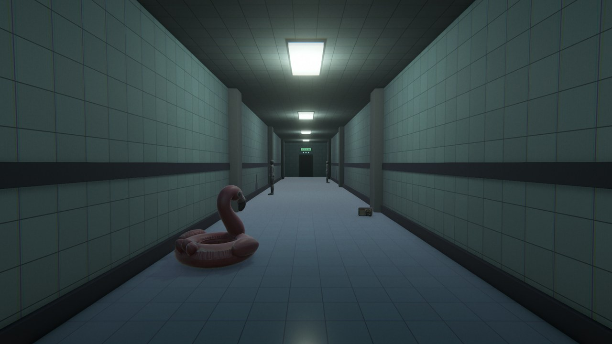
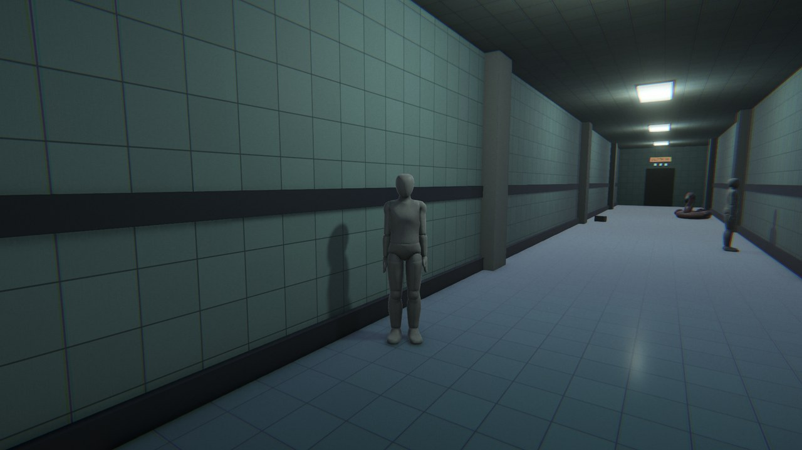
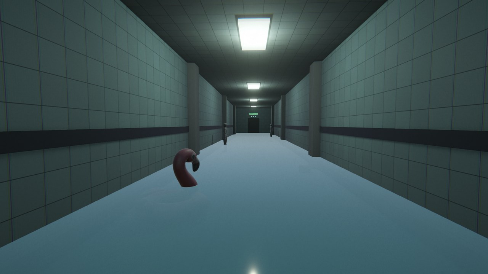
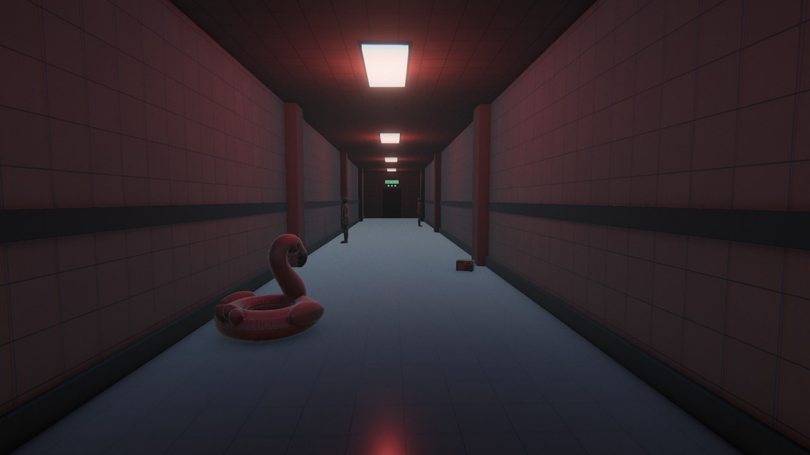
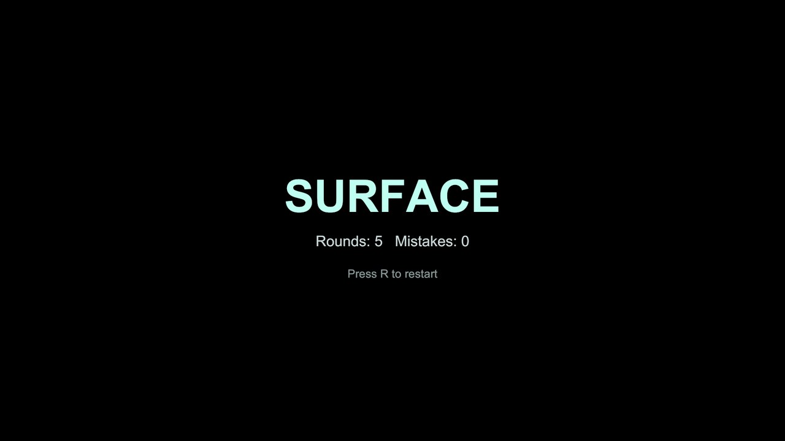

# DEPTH 5m

> 수영장 복도에서 이상현상을 찾아내고, 5m 깊이에서 수면(SURFACE)까지 올라가는 1인칭 서브틀 호러 탈출 게임



Unity 게임 프로토타입 (2차 평가 제출작) · 제작: 우진

---

## 게임 소개

플레이어는 타일로 둘러싸인 **40m 길이의 수영장 복도** 한쪽 끝(뒷문)에서 시작합니다.
복도를 끝까지 걸어가며 **평소와 다른 점(이상현상)** 이 있는지 살펴보고, 그 판단에 따라 문을 선택합니다.

| 상황 | 올바른 선택 |
| --- | --- |
| 이상현상이 **없다** | 앞쪽 문으로 계속 전진 |
| 이상현상이 **있다** | 뒤로 돌아가 뒷문으로 되돌아가기 |

- 맞히면 벽의 **수심 표지판이 1m씩 줄어듭니다.** (5m → 0m)
- 5라운드 연속으로 맞히면 **SURFACE (탈출 성공)**
- 틀리면 **수심이 5m로 초기화**되고 **정신력 램프가 1개 꺼집니다.** (총 3개)
- 램프가 모두 꺼지면 **DROWNED (게임 오버)**

UI를 화면에 따로 띄우지 않고, 수심 표지판과 정신력 램프를 **게임 세계 안에** 배치해 몰입감을 높였습니다.

---

## 실행 방법

1. 이 저장소의 **[Releases v1.0](https://github.com/rhdnwls31-arch/PoolRooms_Eval01/releases/tag/v1.0)** 에서 빌드 zip 파일을 받습니다.
2. 압축을 풀고 `PoolRooms_Eval02.exe` 를 실행합니다. (Windows PC)
3. 플레이 영상도 같은 Releases 페이지에 올려 두었습니다.

## 조작법

| 키 | 동작 |
| --- | --- |
| `W` `A` `S` `D` | 이동 |
| 마우스 | 시점 회전 |
| `Shift` | 달리기 |
| `ESC` | 일시정지 / 재개 |
| `R` | 결과 화면에서 다시 시작 |

---

## 이상현상 8종

1. 마네킹이 몸을 돌려 플레이어를 쳐다봄
2. 마네킹이 한 개 더 나타남
3. 마네킹의 머리만 돌아감
4. 천장 조명이 붉게 변함
5. 형광등이 깜빡임
6. 플라밍고 튜브의 위치가 바뀜
7. 라디오의 위치가 바뀜
8. 바닥에 물이 차오름

규칙 요약
- 첫 라운드는 **항상 정상** 상태로 시작합니다. (기준이 되는 모습을 먼저 보여 줌)
- 정상이 2번 연속 나오면 다음 라운드는 **반드시 이상현상**이 나옵니다.
- 같은 이상현상이 연속으로 나오지 않습니다.

| | |
| --- | --- |
|  |  |
|  |  |

---

## 프로젝트 구조

```
Assets/
├─ Scenes/Scene_Game.unity        게임 씬 (복도, 플레이어, 소품, 후처리)
├─ Scripts/
│   ├─ PlayerController.cs        1인칭 이동 · 시점 · 달리기
│   ├─ CorridorTrigger.cs         앞/뒤 문 도착 감지
│   ├─ GameManager.cs             라운드 · 수심 · 정신력 · 승패 · 화면 전환
│   ├─ AnomalyManager.cs          이상현상 8종 선택과 적용
│   ├─ MannequinTracker.cs        마네킹이 플레이어를 바라보는 동작
│   ├─ ScreenFader.cs             페이드 인/아웃
│   └─ PauseMenu.cs               ESC 일시정지
├─ Materials/Env/                 벽 · 바닥 · 문 · 물 등 머티리얼
├─ Textures/Env/                  수영장 타일 텍스처
└─ Settings/Horror_PostFX.asset   후처리 (모션블러, 비네팅 등)
```

### 스크립트가 하는 일

- **GameManager** : 한 라운드를 시작하고, 플레이어가 복도 끝에 닿으면 정답 여부를 판정합니다. 정답이면 수심 표지판을 줄이고, 오답이면 수심을 되돌리고 정신력 램프를 끕니다. 정신력이 줄어들수록 화면 가장자리가 어두워집니다.
- **AnomalyManager** : 라운드마다 이상현상을 하나 고르고(직전과 같은 종류는 제외), 라운드가 끝나면 모두 원래 상태로 되돌립니다.
- **MannequinTracker** : 마네킹의 몸 전체 또는 머리 뼈만 플레이어 쪽으로 부드럽게 돌립니다.

---

## 사용 기술

- Unity 6.6 (6000.6.0f1) · Universal Render Pipeline (URP)
- 새 Input System, CharacterController
- URP Volume 후처리 (Motion Blur, Vignette, Film Grain, Chromatic Aberration, Color Adjustments, Bloom)
- 코루틴을 이용한 페이드 및 화면 전환
- C#

사운드는 이번 프로토타입 범위에 포함하지 않았습니다.

## 에셋 출처

- 마네킹 · 플라밍고 튜브 · 라디오 등 소품 : 1차 평가에서 직접 제작한 3D 에셋 (Blender 모델링 → FBX)
- 복도 구조, 머티리얼, 후처리 설정, 스크립트 : 2차 평가에서 제작
- 개발 과정에서 AI(Claude)의 도움을 받았으며, 요청 내용과 오류 해결 기록은 포트폴리오 PDF에 정리했습니다.

## 개선하고 싶은 점

- 사운드(발소리, 환경음, 이상현상 효과음) 추가
- 이상현상 종류와 복도 변화 늘리기
- 스테이지 여러 개, 난이도 변화
